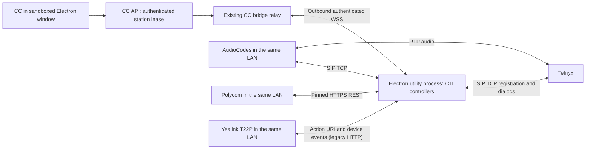

# Contact Center Desktop CTI prototype

This development prototype opens the existing Contact Center UI in Electron and
runs CTI controllers in an Electron utility process. It targets AudioCodes
420HD/440HD, Polycom VVX 300 and Yealink T22P. It does not bundle Asterisk, a database or a Telnyx
account API key.



## Run from the repository

For development, use a full checkout of this repository with its root
dependencies installed (`corepack yarn install
--immutable`, Node 22.12 or later), then install the Electron dependencies:

```sh
cd tools/contact-center-desktop
npm ci
npm start
```

On macOS, double-click **Launch Contact Center.command**. It prefers the packaged
app described below when available, otherwise it runs the source prototype.
On first launch enter
only your Contact Center HTTPS address, then sign in normally. The existing lab
profile is imported once from `private/config.json` if the launcher finds it.
`--config=/absolute/path.json` remains an administrator-only migration option;
normal users do not edit configuration files.

## Environments and Settings

A clean installation opens **Welcome to Contact Center**. Enter a name and the
organization's Contact Center URL, then choose **Save and connect**. The package
contains no customer URL or predefined tenant list. A domain entered without a
scheme uses HTTPS. Only loopback development addresses may use HTTP; credentials,
page paths, query parameters and fragments are rejected.

Open **Telnyx Contact Center → Settings…** (`Cmd+,` on macOS, `Ctrl+,` on Windows)
to add named environments, rename them, choose the startup default, connect or
remove an unused environment. The **Environment** menu is a quick switcher.
Changing the default affects the next launch; it does not interrupt the current
session. The active environment is also included in the main window title.
Use a new environment for a different domain: editing a saved URL in place is
intentionally disabled to keep credentials bound to their original environment.

Each environment has its own persistent browser session, cookies, local storage,
headset permissions, computer enrollment, phone credentials and recovery copies.
Private enrollment data remains in OS-encrypted storage. The existing single-URL
profile migrates once, retaining its browser partition, sign-in and phone settings.
An environment with enrolled phones or recovery copies cannot be removed through
the normal Settings UI; release those phones and archive the enrollment first.
Removing an unused environment clears its stored browser session.

One environment and one bridge run at a time. Switching requires confirmation,
stops the previous bridge before starting the next, clears discovery results and
opens the target's isolated session. It never reprovisions or transfers a phone
between tenants. Phones using the old bridge as a SIP proxy are unavailable until
that environment is reopened. Detected active calls, discovery/setup and an
in-progress Google sign-in block switching. Older CC servers without the desktop
call-state notification still show the explicit finish-calls warning; upgrade
them to obtain the WebRTC call guard. A connection failure offers **Try again**
and **Open Settings** without losing the environment list.

For an isolated first-run acceptance test, `CC_DESKTOP_USER_DATA_DIR` may point
to a new absolute temporary directory. It is unset for normal installations.

## Google sign-in

Choose **Continue with Google** in the desktop app. Your default system browser
opens Google account selection. After successful authentication, the desktop app
comes to the foreground and opens **Choose your phone**. No confirmation code,
copy/paste, custom URL protocol registration or local bridge configuration is
required. **Cancel** in the desktop app closes the pending attempt; otherwise it
expires after five minutes. Start a new attempt if you closed the browser tab.

The same implementation serves macOS and Windows. Electron briefly listens on
an OS-selected port on `127.0.0.1`, not a LAN interface. The server redirects the
browser to that listener with a one-use grant. Redemption requires both the
grant and a random verifier retained in Electron's main process (S256 challenge).
The grant is never available through polling; a forwarded browser link alone
cannot sign another computer in. A one-use HttpOnly browser cookie binds the
browser transaction, and completion requires a fresh Google-authenticated JWT
and an active account. Expired, cancelled and consumed requests fail closed.

The application's existing Google **web** OAuth configuration remains on the
backend: `GOOGLE_ID`, `GOOGLE_SECRET`, and the environment's canonical
`NEXTAUTH_URL` with `/api/auth/callback/google` registered at Google. Google still
redirects to that HTTPS backend; the loopback grant is the Contact Center's own
session handoff. Do not add the random local port to Google's redirect list or
bundle a Google client secret in Electron. Local development may open CC on
`localhost` while using its configured public HTTPS OAuth callback. The native
session is created only on the originally selected environment's origin.

Upgrade the CC backend and desktop package together. Older desktop clients
retain their explicit code-confirmation flow; the new client never silently
falls back to it. Browser Google sign-in and username/password sign-in remain
available. Environment switching is blocked until desktop authentication ends.

## Desktop packages for macOS and Windows

Run `npm run package:mac` in this directory to build a standalone application for
the current Mac architecture. The Apple Silicon output is
`dist/Telnyx Contact Center-darwin-arm64/Telnyx Contact Center.app`; open it directly
or copy it to `/Applications`. The package supplies the Telnyx application name,
Dock icon and bridge-window logo. Its CTI and onboarding workers are bundled;
running it does not require the source checkout, Node.js or repository dependencies.
Private configuration, `.env` and enrollment backups are excluded by an explicit
packaging allowlist.

Local builds are ad-hoc signed development builds, not Apple-signed/notarized
distribution installers. Set `CC_DESKTOP_SIGN_IDENTITY` to an installed Apple
code-signing identity for release signing. The packager gives the app and helper
executables distinct, reproducible build UUIDs before signing; shared Electron
framework UUIDs are retained. This avoids collisions with other Electron apps in
macOS network privacy tracking. A changed code signature may require the user to
confirm access to the existing Keychain entry again. No system privacy settings
are modified by the build. Existing
prototype sessions and encrypted enrollment use the same profile directory and
internal Keychain identity, so upgrading to the branded app does not require
reconfiguring phones. Changing that internal identity would make existing
encrypted settings unreadable.

### Build downloadable packages

From this directory after `npm ci`:

```sh
# Apple Silicon: standalone .app, drag-to-Applications DMG, ZIP
npm run package:mac:dist -- --arch=arm64
# Intel Macs: separate application and archives
npm run package:mac:dist -- --arch=x64
# Windows x64: per-user NSIS installer and portable ZIP
npm run package:win:dist -- --arch=x64
```

Use `--out=/absolute/output/directory` to keep a candidate separate from a running
app. `package:mac` and `package:win` produce unpacked applications only. The
Windows packager also accepts `--arch=arm64`; that target requires its own testing.
The NSIS installer offers an installation directory, does not request elevation,
does not automatically launch after installation, and retains user data on
uninstall. A portable ZIP must be extracted in full, not just its `.exe` file.

Outputs remain under ignored `dist/`. Each target writes SHA-256 checksums and a
build manifest with source commit, dirty-tree status, Electron version and bundled
input paths. Dirty working-tree builds are local candidates, not release evidence.
Neither a successful cross-build nor the manifest proves Windows hardware support;
run installation, upgrade, uninstall, first-run Settings, authentication,
DPAPI, LAN discovery, phone CTI and headset HID acceptance on Windows before release.

Workers are bundled from an audited dependency boundary. Desktop diagnostics
replace the server logging backend, excluding PostgreSQL, AWS SDK and server
log archives. Optional native WebSocket accelerators are excluded so a macOS
addon cannot accidentally enter a Windows build. The package retains application,
Electron and bundled dependency license notices. The build tooling pins a patched
`global-agent` for the older downloader used by electron-builder; keep the lockfile
and rerun the dependency audit when updating the toolchain.

### Public distribution

Publish installers as **GitHub Release assets**, linked from the public README
or the Contact Center download page. Do not commit `.app`, DMG, EXE or ZIP build
outputs into a source folder or Git LFS. Releases should have an immutable desktop
version tag, platform/architecture labels, minimum supported CC server version,
release notes, SHA-256 checksums and a record of the tested source commit.

The public shared repository receives only its reviewed, sanitized source
snapshot. Build public desktop releases from that exact public commit on isolated
macOS and Windows runners. Do not upload a binary built from an internal dirty
checkout: compiled Electron JavaScript (including ASAR) is extractable. Internal
source, test accounts, real phone inventories, environment files, enrollment
backups, tenant URLs, API keys and `TELNYX_PHONE_ADMIN_PASSWORD` must never be
embedded in an installer. The app asks for the customer's CC URL on first run;
credentials are obtained at sign-in/enrollment and stored using OS protection.

Distribution decision (2026-10-21): initially offer **unsigned community/preview
releases** and the corresponding reviewed public source with build instructions.
Do not use the maintainer's personal Apple Developer account or private signing
identity. On macOS retain the technical ad-hoc signature: it uses no Developer ID
certificate and does not establish a verified publisher or Apple notarization.
Windows candidates remain unsigned. Label this explicitly on the release page;
enterprise device policies may prevent installation altogether.

Public source permits review and independent builds, but does not by itself prove
that a downloaded executable matches that source. Publish the exact source tag,
locked dependencies, build instructions, CI provenance where available and SHA-256
checksums. Checksums obtained from the same compromised release cannot authenticate
its publisher. Independent builds still require trust in the source and toolchain;
customers may sign their own builds under their organization's distribution policy.

If verified-publisher releases are introduced later, use an organizational signing
identity: Apple Developer ID plus notarization/stapling, and Windows Authenticode.
`CC_DESKTOP_SIGN_IDENTITY` remains an opt-in build capability, not authorization to
use a personal identity. The Windows candidate script does not configure signing;
a future signed release job must sign the app before packaging and sign the
installer/uninstaller as well. Keep signing keys in a restricted CI signing
service/keychain, never the repository or application. Signing authenticates the
publisher; new Windows releases can still show SmartScreen reputation warnings.

Unsigned distribution does not itself disable HTTPS, microphone permission checks
or OS credential encryption. However, macOS may ask for Keychain access again
after an ad-hoc rebuild. Do not recommend globally disabling Gatekeeper or endpoint
protection; any installation exception belongs to the user or their IT administrator.

Use a protected release environment and a reviewed tag for signing/publishing;
ordinary PR builds have no signing or publication credentials. Dependency and
secret scans, payload review, license/SBOM generation, native acceptance and
checksum verification precede publication. Update feeds and automatic updates are
not implemented by these scripts; until that feature is added, distribute upgrades
manually through the same Release channel with its signing status stated. CI should publish only explicit artifacts,
not the complete output directory (which contains local build/debug metadata).

## Headset audio and call controls

The desktop shell enables WebHID for Jabra, Poly/Plantronics and EPOS/Sennheiser
USB devices that expose a Telephony collection. Permission is restricted to the
configured Contact Center origin and its dedicated session. Other USB/HID
devices and other origins are denied; the Chromium HID blocklist stays enabled.
The existing vendor adapters still decide whether a particular report layout
supports call controls. Discovery alone does not establish model compatibility.
Chrome's grants do not carry over to Electron; the shell now supplies this
headset permission policy itself, including the Add headset chooser.

EPOS/Sennheiser call control continues to use EPOS Connect on this computer;
the configured CC document may reach its loopback SDK. Connecting a headset
directly over Bluetooth may provide audio without exposing its USB call-control
transport. Use the manufacturer's supported USB adapter when required.

Choosing **Use this device** also selects the matching ready call controller.
The matcher supports SDK names and catalog IDs as well as real USB VID/PID,
and waits up to 20 seconds for delayed vendor discovery. It does not choose
between two indistinguishable devices, override a newer manual choice, or switch
controllers during a call. Unplugging audio returns it to the system defaults.

The app stores enrollment credentials, phone credentials and recovery copies
with Electron `safeStorage` (macOS Keychain / Windows DPAPI). It fails closed if
OS encryption is unavailable. It never exposes the server's managed password,
SIP passwords or bridge token through the remote-renderer preload. A local
password entered by the user is passed only to the native setup helper.

## Setting up one home agent

1. Connect the computer and phone to the same LAN and open Contact Center Desktop.
2. Sign in. The compact phone picker adds **Nearby**, **My phones** and
   **Organization stations**. These groups filter the existing authorized
   station inventory; discovery does not grant access to another user's phone.
3. Choose **Find / configure phones**, or use the app menu **Find and configure
   phones**. Select **Find phones**, then select a discovered handset.
4. For a previously enrolled phone, the app uses its encrypted credentials.
   For a new phone, it tries the documented factory password once. If rejected,
   it asks for the phone's administrator password. Model, MAC and supported
   firmware are checked after authentication. TLS fingerprints are pinned.
   If a previously enrolled phone was reset, an explicit stored-password
   rejection also permits that single factory-password attempt. Network and
   identity errors never trigger password guessing.
5. Choose **Configure phone**. CC allocates a phone extension when missing,
   preserves an existing extension and custom line label, and creates/links the
   scoped desktop bridge. Existing owners, occupied stations and another bridge's
   phones are protected. A shared existing phone requires administrative access
   for reconfiguration. The app saves an encrypted recovery point before writing
   settings and verifies the result on the actual handset. AudioCodes is then
   restarted to activate its SIP proxy settings, with a registration check
   after restart. This can take several minutes.
   The phone grid stays visible while configuration runs. The selected tile
   shows a spinner, and the detail area reports saving, password verification,
   restarting, waiting for the phone, and SIP registration with elapsed time.
   If settings are saved but activation remains unconfirmed, **Check activation**
   retries status verification without rewriting settings or rebooting the phone.
6. Return to the picker and select the phone. Normal mini/floating CTI continues
   through the existing ACD service. The app menu offers **Start at login**;
   closing the main window keeps the helper running.

The server must define `TELNYX_PHONE_ADMIN_PASSWORD`. **Every provisioned phone
uses this common managed administrator password**, including phones configured
through Electron. Factory or user-entered passwords are bootstrap credentials
only. The app writes the managed password and verifies a fresh authenticated
request before completing enrollment. Periodic provisioning also uses the env
value, overriding stale per-phone values. Missing or incompatible managed
passwords stop setup before changing a handset. Do not place `.env` on agents'
computers; the authenticated setup endpoint supplies only the configuration for
the handset being enrolled to the native process.

## Desktop sign-in

Credentials sign-in stays on the application's configured origin and navigates
to `/signin/phone`. This also works when local development uses `localhost` but
the canonical NextAuth address is the public HTTPS tunnel.

Google sign-in uses the system browser and automatically returns to the desktop phone picker. See the Google sign-in section above for the current one-use, verifier-bound handoff.

Discovery probes directly connected private IPv4 LANs, excludes named VPN and
virtual interfaces, and is bounded. ARP is an optional hint: macOS may return an
empty table to GUI apps. Public vendor responses and encrypted prior enrollment
addresses provide fallback discovery; prior addresses are never sufficient proof
of device identity. The current scan covers up to 254 addresses per interface
and 1,024 overall, plus neighbors within that bound. Phones behind isolated Wi-Fi,
other VLANs or public/VPN routes are not automatically discovered. Network or
computer-IP changes still require reconfiguration; automatic roaming of already
proxied AudioCodes phones is not implemented.

The cloud must expose the existing authenticated bridge relay over WSS and run
this branch's `/api/telephony/desktop` endpoint. Normal users need experimental
features and voice enabled; an extension pool must already exist. New enrollment
is limited to eight phones per non-administrator. The Electron app opens no WAN
ports: AudioCodes reaches local TCP 5070 and Yealink local TCP 5071. OS local
network/firewall permission may still be needed. Never distribute enrollment profiles between users.

| Tested handset | One-time LAN configuration | If Electron is stopped |
| --- | --- | --- |
| AudioCodes 420HD / 440HD | Existing Telnyx account; TCP outbound proxy = computer IP:5070; SIP talk event enabled; pinned HTTPS management credentials for Dial | SIP proxy and CTI are unavailable. Restore the old outbound proxy before retiring the app. |
| Polycom VVX 300 | Direct Telnyx SIP registration (TCP by default for desktop enrollment, unless an explicit transport is configured); REST API enabled; HTTPS certificate fingerprint and management credentials enrolled locally | Direct handset calling remains available; desktop CTI is unavailable. |
| Yealink T22P | Direct Telnyx SIP registration; Action URI restricted to computer IP; token-protected Action URL callbacks to port 5071; physical remote-control approval | Direct handset calling remains available; desktop CTI is unavailable. |

These settings are model/firmware-specific. The tested T22P still uses legacy LAN
HTTP management and cannot download provisioning over the current public HTTPS
tunnel (TLS 1.0 without SNI). A newer Yealink model needs separate qualification.
Windows code paths exist, but Windows device acceptance and signed installer
support remain unfinished. Do not distribute this as a finished home-agent client.

The backend must include this prototype's `desktop_bridge` driver and registry
extensions. Assign the phone's `local_bridge_id` to the enrolled bridge and
`settings.cti_mode` to `desktop_bridge`. The private local allowlist and the
server-side registry must both authorize the phone. The registry supplies model,
address, SIP username and extension; it does not send SIP passwords or phone
administrator credentials for this mode.

The AudioCodes must use its existing Telnyx registration credentials and the
desktop's LAN address as its SIP outbound proxy, TCP port 5070. Enable the SIP
talk event. Back up the configuration, verify the device MAC and idle state,
apply only the required parameters, read them back and restart the phone when
required by its firmware. Do not change the phone's DID, Telnyx Caller ID
Override or codec ordering as part of desktop enrollment.

For local development, HTTP/WS are allowed only on loopback. Remote application
and relay URLs must use HTTPS/WSS. No router port forwarding is needed. The
computer still needs to accept the phone's TCP connection on its LAN interface;
macOS local-network/firewall permission or Windows firewall permission may be
required. The prototype does not change operating-system firewall rules.

## AudioCodes control semantics

- Answer and hold/resume send in-dialog SIP NOTIFY and wait for the subsequent
  INVITE/SDP state change. A NOTIFY 200 response alone is not success.
- Mute negotiates receive-only audio at the phone using an in-dialog re-INVITE.
  This is media mute; it does not promise that the physical mute LED changes.
- Call references are generated per observed SIP dialog. Commands for stale
  references, multiple active calls, another phone or an arbitrary host fail.
- Outbound calls, queue caller ID, internal extensions and blind/consult
  transfers continue through the existing CC/ACD and Telnyx workflows. The
  Electron bridge controls the physical agent leg.
- The CC renderer has no Node integration. A narrow, origin- and sender-checked
  preload exposes discovery, login and setup; it exposes no arbitrary IPC, URL,
  filesystem or network primitive. A separate local status window is read-only.
- The cloud connection uses a bridge-scoped token. Commands are not queued during relay
  outages. Transient WSS loss leaves the existing SIP flows running.

## Lifecycle and prototype limitations

Closing the CC window keeps the helper running. The application menu provides
the bridge status window and an explicit Quit action with a warning. Quitting,
sleeping, losing LAN connectivity or crashing the desktop interrupts AudioCodes' SIP
proxy path. Restore the previous outbound-proxy settings before retiring the
prototype. Signed/notarized installers, automatic proxy failover, automatic network roaming
and Windows acceptance testing are not implemented. Managed enrollment is provided
by the new setup wizard, with recovery copies for uncertain hardware writes.

The current prototype uses SIP/TCP for these legacy models, with media directly
between the handset and Telnyx. It is not a media relay. Production transport
policy, reconnect behavior and firmware compatibility require separate
qualification.

AudioCodes desktop provisioning sets `registration_failed_timeout=15` seconds.
After a desktop restart, the phones may first send a registrar OPTIONS probe
while Telnyx still has the old TCP registration binding. A new, unregistered
controller flow returns SIP 503 with `Retry-After: 15` to that out-of-dialog
probe, prompting a fresh authenticated REGISTER. After successful registration,
OPTIONS passes through normally; provider and in-dialog probes are unchanged.
This avoids a misleading keep-alive 200 that leaves the old binding unusable
until the regular registration refresh. Recovery is not instantaneous: the
phone's configured keep-alive interval and network detection add to the retry.
The app must remain running for AudioCodes calling in this proxy mode.

`CC_DESKTOP_DEBUG_PORT` enables loopback Chromium debugging for controlled
acceptance tests only. `CC_DESKTOP_EVENT_LOG` optionally writes SIP event
metadata without raw SIP frames or credentials. Neither option is needed for
normal use. Keep the bridge token outside the repository.

## Polycom and Yealink native CTI

The helper also runs the shared Polycom REST driver and a T22P Action URI
adapter. Their SIP registration and RTP continue directly to Telnyx: the
Electron SIP proxy is used only for AudioCodes. Closing Electron removes remote
CTI for Polycom/Yealink but does not remove their direct SIP registration.

The wizard creates `eventPort` (5071) and `nativePhones` in encrypted storage.
For administrator-managed legacy imports, the equivalent configuration contains
these fields. Each entry must contain the exact `id`, `vendor`,
`model`, normalized `mac`, `ip_address` and `admin_password`. Polycom also requires
the enrolled SHA-256 `certificate_fingerprint`. AudioCodes native Dial entries
require the same pinned certificate and private web credentials; their management
transport must be HTTPS. T22P requires a random 32-byte hex
`event_token` and `settings: {"management_protocol":"http"}`. The latter is an
explicit legacy LAN management transport; this does not solve the T22P firmware's
TLS 1.0/no-SNI public provisioning limitation. Newer Yealink models are not yet
qualified by this prototype. Credentials are migrated to OS-encrypted local storage,
never the cloud command, remote renderer, status window or event log.

Configure the idle T22P's event callbacks with:

```sh
node configure-yealink.mjs configure /absolute/private-config.json /absolute/private-backup.json
# Restore before retiring the test setup:
node configure-yealink.mjs restore /absolute/private-config.json /absolute/private-backup.json
```

The setup tool verifies the MAC/firmware, restricts Action URI to the computer's
LAN IP, backs up affected fields, preserves SIP/account settings and reads back
every changed field. Missed and rejected calls have terminal callbacks as well, so an unanswered
ring does not remain active in the toolbar. The local event listener accepts only the enrolled phone's
source IP and per-phone token. Include `$remote` and `$local` in the action
URLs so a Dial acknowledgement can be matched to the actual destination. No router port forwarding is required. Firmware
may require its one-time physical remote-control approval.

Polycom uses certificate-pinned HTTPS, explicit mute state and call references.
Yealink uses call-specific answer/hold/resume/hangup and its hardware mute toggle;
the helper waits for a matching phone event before reporting success. Duplicate
command IDs are coalesced so retries cannot toggle mute twice. DTMF is verified
separately against Telnyx during acceptance. Blind and consultation transfers
remain ACD operations, including release of the agent's capacity.

T22P does not expose a readable call inventory. After starting the helper its
call state is unknown until a real incoming/outgoing call event is received;
origination stays disabled until an observed call ends. Use the station's test
ring (or complete a handset call) to initialize it. The helper never assumes an
idle handset after a restart, or claims success from HTTP 200 alone. Callback
loss/reordering, sleep/recovery and fleet management need further production
qualification. Do not treat this prototype as a production installer.

## Direct handset origination

A deskphone CTI Dial creates a durable ACD intent containing the chosen queue or
personal caller ID and the resolved destination, then sends one bounded command
to the enrolled desktop. Polycom uses REST Dial; Yealink uses the Action URI
`key=number=...&outgoing_uri=...`; AudioCodes uses its authenticated directory Dial
form (`dial.htm` on 420HD, `Dial.htm` on 440HD). The AudioCodes SIP REFER path is
not supported by the two tested 2.2.16 firmware builds (501).

The phone originates its own SIP INVITE. CC binds that incoming parked event to
the pending intent and connects the destination with the frozen caller identity.
There is no incoming callback to the handset and no agent Answer action for an
outgoing call. HTTP acceptance alone does not prove a call: AudioCodes waits for
the matching SIP INVITE and Yealink for an outgoing device event. Device state
and the public Telnyx webhook keep the toolbar and ACD lifecycle synchronized.

A lost or ambiguous Dial response is never automatically redialed. Capacity is
retained until SIP/provider evidence resolves the intent. The browser user's
separate WebRTC credential cannot establish absence of a deskphone call. These
controls prevent duplicate calls and conflicting agent assignments.

## Factory defaults and qualification

| Tested firmware family | Factory web credential | Automatic setup prerequisite |
| --- | --- | --- |
| Poly VVX 300 UCS 5.9.8 | Admin role; HTTP Basic username `Polycom`, password `456` | REST API must already be enabled. The wizard reports this prerequisite if unavailable; enabling REST on a factory-reset phone is not yet automated. |
| AudioCodes 420HD / 440HD 2.2.16 | `admin` / `1234` | Reachable HTTPS management and an idle phone. |
| Yealink T22P 7.73 | `admin` / `admin` | Legacy local HTTP; an unused SIP account for initial account setup, or the matching registered CC account. Physical remote-control approval may be required. |

Sources: [Poly UCS administrator guide](https://kaas.hpcloud.hp.com/pdf-public/pdf_9122088_en-US-1.pdf),
[AudioCodes 400HD 2.2.16 administrator manual](https://www.audiocodes.com/media/y1zljbeb/400hd-series-ip-phone-administrators-manual-ver-2216-m20-generic-sip.pdf),
[Yealink T22P V73 user guide](https://support.yealink.com/forward2filesystem/attachment/upload/attachment/2015-3-12/3/8570f6a3-4bff-4119-b12e-f6c8d7ae2267/Yealink_SIP-T22P%2B%26%2BSIP-T22_User_Guide_V73_40.pdf?v=1426119467000).

Qualification is model- and firmware-specific. Factory-reset automation has been exercised on AudioCodes 420HD; factory resets of the other listed models still need qualification. Windows native installation, device, HID and OS credential-storage acceptance is pending. Treat this release as an unsigned community preview.
